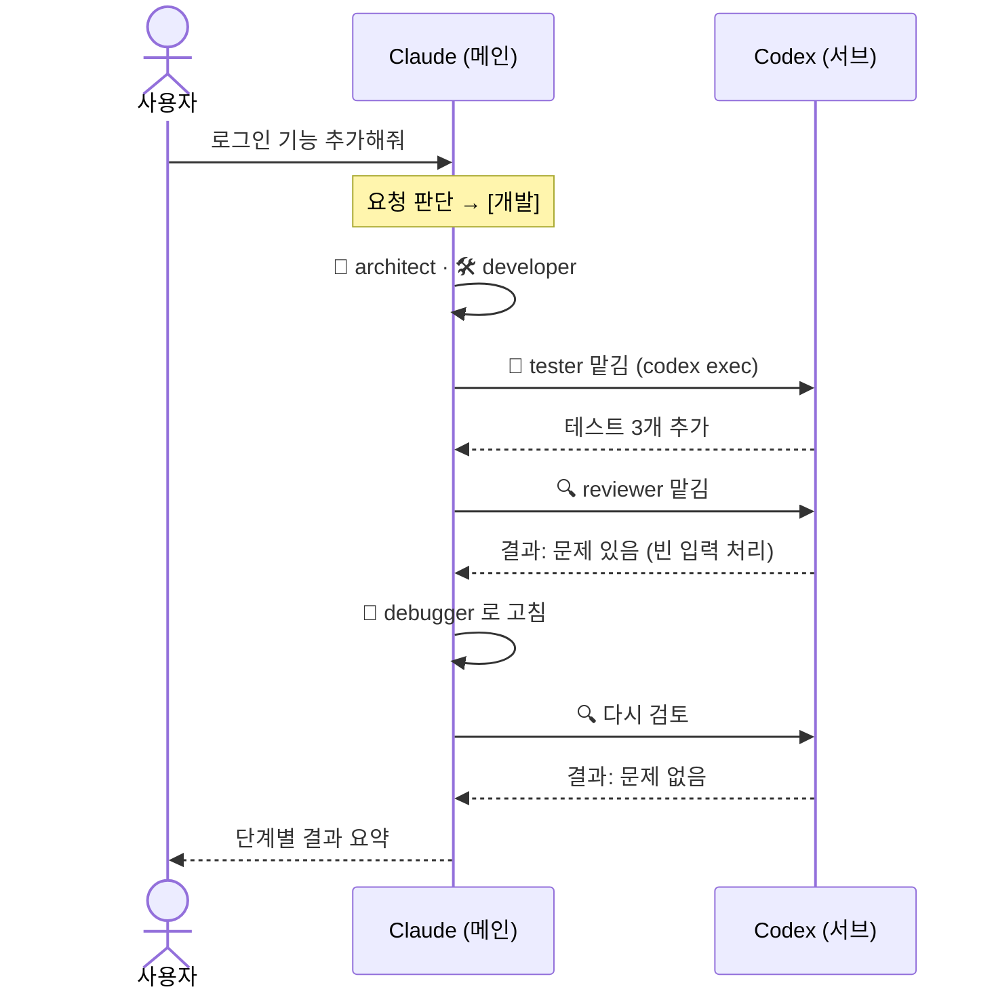

<div align="center">

# 🎖️ hn-commander

**Claude Code와 Codex에게 역할을 나눠 주고, 한 팀처럼 일하게 만드는 하네스**

역할마다 맡을 에이전트를 프로젝트별로 정하면, 요청에 필요한 역할만 순서대로 움직이고<br>
담당이 다른 에이전트면 자동으로 불러서 넘깁니다.


-000000?style=flat-square&logo=apple&logoColor=white)


</div>

---

## ✨ 무엇을 해 주나요

| | |
|---|---|
| 🧱 **하네스 세팅** | `CLAUDE.md` · `AGENTS.md` · 진행/결정 기록 · 역할 지침을 프로젝트에 맞게 한 번에 만듭니다 |
| 🎭 **역할 배정** | 9개 역할을 Claude / Codex / 배정 안 함 중에서 질문에 답하듯 고릅니다 |
| 🧭 **요청에 맞는 역할만** | 질문엔 답만, 개발 요청엔 설계 → 구현 → 테스트 → 검토까지 |
| 🔁 **자동 넘기기** | 다음 담당이 다른 에이전트면 그 CLI를 불러 맡기고 결과를 받아 이어갑니다 |
| 🪙 **토큰 절약** | 필요한 문서만 읽고, 넘길 때는 대화 전체가 아니라 목표·결과 요약만 넘깁니다 |

---

## 📦 설치

> 필요한 것: [Claude Code](https://claude.com/claude-code) 또는 [Codex CLI](https://github.com/openai/codex) (둘 다 쓰면 역할 나누기 가능) · Windows는 [Git for Windows](https://git-scm.com/download/win)

### Windows 11 (PowerShell)
```powershell
iex (irm https://raw.githubusercontent.com/pwdks/hn-commander/main/install.ps1)
```

### macOS (Apple Silicon 포함, 터미널)
```bash
curl -fsSL https://raw.githubusercontent.com/pwdks/hn-commander/main/install.sh | bash
```

설치하면 `~/.hn-commander/`에 내려받고, 두 명령을 Claude Code와 Codex 모두에 등록합니다.

| | Claude Code | Codex |
|---|---|---|
| 처음 세팅 | `/hn-setup` | `$hn-setup` |
| 역할 배정 바꾸기 | `/hn-mod-role` | `$hn-mod-role` |

### 🔄 업데이트

**위의 설치 명령을 다시 실행하면 끝입니다.** 내 컴퓨터의 hn-commander와 함께, 세팅해 둔 프로젝트 전부가 최신 버전으로 바뀝니다. 그다음 Claude Code / Codex를 다시 켜세요.

```
hn-commander 0.1.2 installed -> C:\Users\me\.hn-commander
...
Updating projects:
  업데이트 docs/roles/03-tester.md
hn-commander 0.1.1 → 0.1.2: /c/Users/me/dev/my-app
hn-commander 0.1.2 (최신): /c/Users/me/dev/other-app
```

| 업데이트로 바뀌는 것 | 그대로 두는 것 |
|---|---|
| `.harness/bin/` 스크립트 | 역할 배정 `roles.conf`, 훅 설정 |
| 역할 지침 `docs/roles/`, 단계 `pipelines.conf` — **손대지 않은 파일만** | 위 파일 중 **직접 고친 파일** (`그대로`로 표시. 새 버전을 쓰려면 그 파일을 지우고 다시 업데이트) |
| `CLAUDE.md`·`AGENTS.md`의 hn-commander 구역 (`<!-- hn-commander:start -->` ~ `end`) | 그 구역 밖의 내용 |

- 프로젝트 목록은 `~/.hn-commander/projects.txt`에 저장됩니다. `/hn-setup`으로 세팅하면 자동으로 들어갑니다.
- **0.1.1 이하에서 세팅한 프로젝트**는 목록에 없습니다. 이번 한 번만, 그 프로젝트 폴더에서 설치 명령을 실행하세요. 지금 폴더의 프로젝트도 함께 업데이트되고 목록에 들어갑니다.
- 프로젝트 하나만 바꾸려면 그 폴더에서 `.harness\bin\hn.cmd update` (macOS: `bash .harness/bin/hn.sh update`).
- 훅 설정은 바뀌지 않으므로 Codex 훅을 다시 신뢰할 필요는 없습니다.

<details>
<summary>🗑️ 삭제</summary>

```powershell
# Windows
& ([scriptblock]::Create((irm https://raw.githubusercontent.com/pwdks/hn-commander/main/install.ps1))) -Uninstall
```
```bash
# macOS
curl -fsSL https://raw.githubusercontent.com/pwdks/hn-commander/main/install.sh | bash -s -- --uninstall
```
프로젝트 안의 `.harness/`, `CLAUDE.md` 등은 지우지 않습니다.
</details>

---

## 🔐 Codex 훅 신뢰하기 (프로젝트마다 한 번)

Codex는 프로젝트에 들어 있는 훅을 **사람이 한 번 확인하고 신뢰(trust)해야** 실행합니다. 자동으로 실행될 명령을 몰래 넣지 못하게 하는 Codex의 안전장치라서, hn-commander도 설치 단계에서 자동으로 신뢰하지 않습니다.

1. `/hn-setup`을 마친 프로젝트 폴더에서 `codex`를 실행합니다.
   처음 여는 폴더라 "이 폴더를 신뢰할까요?"라고 물으면 **예**를 고릅니다.
2. 입력창에 **`/hooks`** 를 치고 **Stop hooks** 로 들어갑니다.
3. 목록의 **`Unnamed hook`** 이 hn-commander 훅입니다. (Codex 훅에는 이름을 붙이는 칸이 없어서 이렇게 보입니다)
   **Command** 가 아래와 같은지 확인하세요.
   - macOS: `bash .harness/bin/hn.sh stop-hook`
   - Windows: `.harness\bin\hn.cmd stop-hook`
4. **Trust** 가 `Trusted` 이고 앞에 **`[x]`** 표시가 있으면 끝입니다. **Esc** 로 나가세요.
   폴더를 신뢰하면 훅도 이미 `Trusted` 로 나오는 경우가 많습니다. 아직 신뢰 전이라면 화면 안내에 따라 신뢰해 주세요.

> ⚠️ 이 화면에서 **Space / Enter** 를 누르면 훅이 꺼집니다(`[x]` → `[ ]`). 실수로 눌렀다면 한 번 더 눌러 `[x]` 로 돌려 두세요.

- `.codex/hooks.json`의 훅 내용이 바뀌면 한 번 더 신뢰해야 합니다. 업데이트는 이 파일을 건드리지 않으니 보통은 다시 할 일이 없습니다.
- **신뢰하지 않아도** 단계 진행과 넘기기는 그대로 동작합니다. Codex가 진행을 맡을 때 "남은 단계 재촉"만 빠집니다.
- Claude Code의 훅은 이 과정이 필요 없습니다.

---

## 🚀 시작하기

```bash
cd my-project
claude            # 또는 codex
> /hn-setup       # Codex: $hn-setup
```

세팅은 질문에 답하면서 진행됩니다.

```
역할 배정이 필요한가요?            1) 예   2) 아니오
배정 방식을 골라 주세요            1) claude 메인 + codex 서브
                                   2) codex 메인 + claude 서브
                                   3) 직접 배정
Tester — 바뀐 동작을 확인하는 테스트를 추가합니다.
어떤 에이전트에게 맡길까요?         1) claude   2) codex   3) 배정 안 함
```

끝나면 평소처럼 요청하면 됩니다. 새 탭(세션)을 열 때마다 따로 할 일은 없습니다.

---

## 🎭 역할

| | 역할 | 하는 일 | 권한 | 프리셋 |
|:-:|---|---|:-:|:-:|
| 🧭 | **orchestrator** · 지휘 | 여러 모듈에 걸친 큰 요청을 역할별 작업으로 나눠 계획을 세웁니다 | 읽기 | 메인 |
| 📐 | **architect** · 설계 | 코드를 고치기 전에 바꿀 파일과 방법을 3~7개 요점으로 정리합니다 | 읽기 | 메인 |
| 🛠️ | **developer** · 구현 | 설계에 맞춰 필요한 최소 범위만 구현합니다 | 수정 | 메인 |
| 🐞 | **debugger** · 디버깅 | 오류를 재현하고 원인을 찾아 최소한으로 고칩니다. 검토 지적도 고칩니다 | 수정+실행 | 메인 |
| 🔗 | **integrator** · 통합 | 나눠서 고친 내용이 서로 맞물리는지 확인하고 어긋난 곳만 고칩니다 | 수정+실행 | 메인 |
| 🧪 | **tester** · 테스트 | 바뀐 동작을 확인하는 테스트를 추가합니다. 경계 조건·실패 경로 포함 | 수정 | 서브 |
| 🔍 | **reviewer** · 검토 | 버그·보안 문제·빠진 처리를 찾습니다. 문제가 없으면 없다고 말합니다 | 읽기 | 서브 |
| 📝 | **documenter** · 문서 | 사용법·설정이 바뀌면 문서를 짧게 갱신합니다 | 수정 | 서브 |
| ⚡ | **optimizer** · 최적화 | 측정 근거가 있을 때만 성능을 개선하고 전후 수치를 남깁니다 | 수정+실행 | 서브 |

- **프리셋** `claude 메인 + codex 서브`를 고르면 "메인" 역할은 Claude, "서브" 역할은 Codex가 맡습니다. 반대 프리셋도 있습니다.
- **배정 안 함**인 역할의 단계는 건너뜁니다.
- 각 역할의 자세한 지침: [`roles/`](roles/)

---

## 💬 요청하는 법

그냥 말하면 에이전트가 요청 종류를 판단합니다. 확실히 하고 싶으면 머리말을 붙이세요.

| 머리말 | 이런 요청 | 움직이는 역할 |
|---|---|---|
| `[질문]` | "이 함수 왜 이렇게 짰어?" | **없음 — 답만 합니다** |
| `[개발]` | "로그인 기능 추가해줘" | architect → developer → tester → reviewer → documenter |
| `[수정]` | "버튼 색 바꿔줘" | developer → tester → reviewer |
| `[버그]` | "저장이 안 돼, 고쳐줘" | debugger → tester → reviewer |
| `[성능]` | "목록 로딩이 느려" | optimizer → tester → reviewer |
| `[테스트]` | "결제 모듈 테스트 써줘" | tester |
| `[검토]` | "지금 변경 검토해줘" | reviewer |
| `[문서]` | "README 갱신해줘" | documenter |
| `[대형]` | "인증 구조 전체를 바꿔줘" | orchestrator → architect → developer → integrator → tester → reviewer → documenter |

> 🛡️ 질문에 엉뚱한 역할이 끼어들지 않도록: 파일을 바꾸라는 요청이 분명할 때만 단계를 시작하고, 애매하면 "수정까지 할까요?"라고 먼저 묻습니다. 단계가 시작되지 않으면 훅도 넘기기도 동작하지 않습니다.

---

## 🔁 자동 넘기기는 이렇게 움직입니다

> 아래는 `claude 메인 + codex 서브` 프리셋일 때의 예입니다. 배정을 바꾸면 담당도 그대로 바뀝니다.



- **진행은 대화 중인 에이전트가** 합니다. Codex에게 말하면 Codex가 진행하고 Claude를 부릅니다.
- 넘길 때는 대화 전체가 아니라 **역할 지침 · 목표 · 앞 단계 결과**만 넘깁니다.
- 넘겨받은 쪽은 역할 권한 안에서만 일하고 **커밋·푸시·재위임을 하지 않습니다.**
- 실행 권한이 없는 역할(tester 등)은 넘겨받으면 테스트를 **쓰기만 하고 돌리지 않습니다.** 돌릴 명령을 적어 돌려주면 진행 중인 에이전트가 한 번 실행해 확인합니다.
- 검토 지적 → 고치기 → 재검토는 **1회까지**. 그래도 남은 문제는 보고만 합니다.
- 응답을 끝내려는데 남은 단계가 있으면 **Stop 훅**이 한 번 이어서 진행시킵니다.

---

## 🗂️ 세팅하면 프로젝트에 생기는 것

```
my-project/
├─ CLAUDE.md               Claude가 매 세션 읽는 지침 (짧게)
├─ AGENTS.md               Codex가 매 세션 읽는 지침 (짧게)
├─ docs/
│  ├─ progress.md          진행 기록 — 새 세션은 여기부터
│  ├─ decisions.md         결정 기록
│  └─ roles/               역할 지침 9개
├─ .harness/               (역할 배정을 했을 때)
│  ├─ roles.conf           역할 배정 — 바꾸는 곳은 여기 하나
│  ├─ pipelines.conf       요청 종류별 단계
│  ├─ bin/hn.sh, hn.cmd    진행·넘기기 스크립트
│  ├─ VERSION              이 프로젝트에 적용된 hn-commander 버전
│  ├─ upstream.sums        업데이트가 '손대지 않은 파일'을 알아보는 기록 (지우지 마세요)
│  └─ state/               진행 상태·결과 (git 제외)
├─ .claude/settings.json   Claude Stop 훅
└─ .codex/hooks.json       Codex Stop 훅
```

---

## 🧰 직접 쓰는 명령 (선택)

보통은 에이전트가 알아서 씁니다. 상태가 궁금할 때만 쓰세요.

```bash
bash .harness/bin/hn.sh roles     # 지금 역할 배정
bash .harness/bin/hn.sh status    # 진행 중인 작업과 단계 기록
bash .harness/bin/hn.sh off       # 하네스 잠시 끄기 (on 으로 다시 켬)
bash .harness/bin/hn.sh codex-sandbox full   # 위임받은 Codex 샌드박스 풀기 (auto 로 되돌림)
bash .harness/bin/hn.sh update    # 이 프로젝트만 설치된 최신 버전으로 (보통은 설치 명령이 대신 함)
```
Windows PowerShell에서는 `.harness\bin\hn.cmd roles` 처럼 씁니다.

---

## ❓ 자주 묻는 것

<details>
<summary><b>새 세션마다 문서를 다 읽나요?</b></summary>

아니요. CLI가 자동으로 읽는 건 `CLAUDE.md` / `AGENTS.md`뿐이고, 역할 파일은 그 단계가 돌 때 해당 파일 하나만 엽니다. `~/.hn-commander/guides/`의 문서는 `/hn-setup` 할 때만 읽습니다.
</details>

<details>
<summary><b>Codex 훅이 동작하지 않아요</b></summary>

Codex는 프로젝트 훅을 처음 한 번 신뢰(trust)해야 실행합니다. 위의 [🔐 Codex 훅 신뢰하기](#-codex-훅-신뢰하기-프로젝트마다-한-번)를 따라 주세요.
</details>

<details>
<summary><b>Codex에 넘긴 단계가 빌드·테스트를 못 돌려요 (sandbox blocked)</b></summary>

넘겨받은 Codex는 샌드박스 안에서 실행됩니다. Windows에서는 이 샌드박스가 빌드 도구(예: Unreal `Build.bat`의 dotnet)나 셸 실행 자체를 `액세스가 거부되었습니다`로 막을 수 있습니다.

- **tester · reviewer 등 실행 권한이 없는 역할**은 원래 실행하지 않습니다. 테스트를 쓰고 돌릴 명령을 적어 주면, 진행 중인 에이전트가 직접 실행합니다. 따로 할 일은 없습니다.
- **debugger · integrator · optimizer를 Codex에 맡겼고 빌드까지 시키고 싶다면** 샌드박스를 풀 수 있습니다: `/hn-mod-role` → "위임받은 Codex 샌드박스 풀기", 또는 `bash .harness/bin/hn.sh codex-sandbox full` (되돌리기: `auto`). 이때 Codex 쪽의 커밋·푸시·삭제는 지시문으로만 막습니다.

이 동작은 0.1.1부터입니다. 이미 세팅한 프로젝트는 [🔄 업데이트](#-업데이트)로 적용됩니다.
</details>

<details>
<summary><b>다른 에이전트를 부르면 비용이 드나요?</b></summary>

네, 부를 때마다 그 에이전트의 사용량이 듭니다. 단계마다 차례로 실행되니 몇 분씩 걸릴 수 있습니다. 필요 없는 역할은 "배정 안 함"으로 두세요.
</details>

<details>
<summary><b>역할을 나중에 바꿀 수 있나요?</b></summary>

`/hn-mod-role` (Codex: `$hn-mod-role`)로 프리셋을 다시 고르거나, 역할을 골라서 바꾸거나, 하네스를 끌 수 있습니다. 바뀐 배정은 다음 요청부터 적용됩니다.
</details>

---

## 📚 하네스 엔지니어링 가이드

| 문서 | 내용 |
|---|---|
| [01 하네스 엔지니어링](guides/01-harness-engineering.md) | 하네스란 무엇이고 CLI에서 어떻게 만드는지 |
| [02 토큰 효율](guides/02-token-efficiency.md) | 토큰을 낭비하지 않는 규칙 |
| [03 템플릿](guides/03-templates.md) | 지침 파일·기록 파일 틀 |
| [04 에이전트 넘기기](guides/04-agent-handoff.md) | 역할 배정·단계·넘기기의 동작 원리 |
